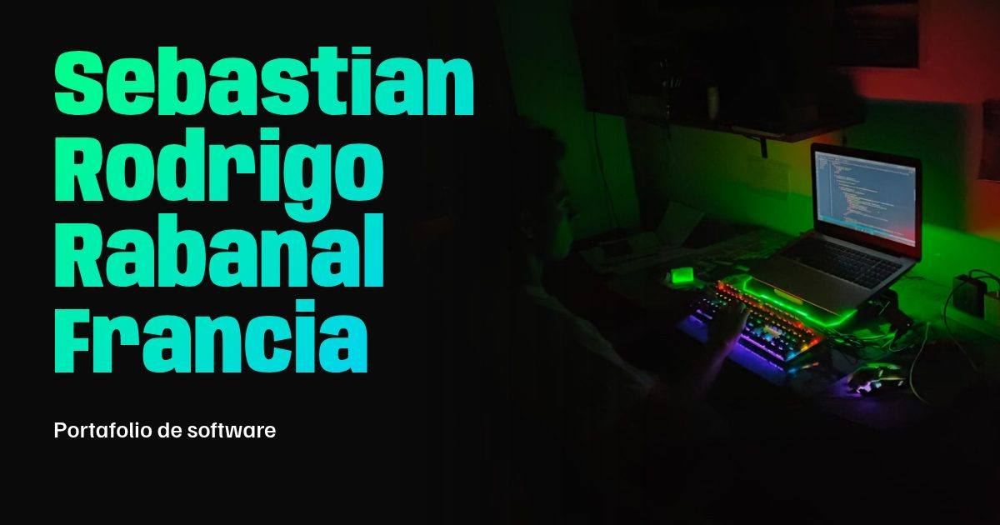

# Portafolio de Sebastian Rodrigo Rabanal Francia

Estudiante de Ingeniería de Sistemas en la Universidad Nacional del Callao.

**Sitio:** <https://corecodev.github.io>



## Tecnologías

[Astro](https://astro.build) genera páginas estáticas con muy poco JavaScript. Las imágenes se optimizan al compilar y las fuentes e iconos van dentro del proyecto.

## Uso local

Requiere Node.js 22.23 o superior.

```bash
npm install
npm run dev      # sitio en http://localhost:4321
npm run check    # revisa los tipos
npm test         # compila y revisa el sitio generado (requiere pdftotext)
```

## Cómo actualizar el contenido

Todo el contenido está en `src/data/`:

| Archivo | Contenido |
|---|---|
| `profile.ts` | Nombre, correo, redes y ruta del CV |
| `projects.ts` | Proyectos. Para agregar uno, añade su imagen a `src/assets/projects/` y una entrada aquí |
| `experience.ts` | Experiencia |
| `skills.ts` | Tecnologías |
| `certificates.ts` | Certificaciones |

Los colores y medidas están en `src/styles/global.css`. El CV que se publica es `public/Sebastian-Rodrigo-Rabanal-Francia-CV.pdf`.

## Publicación

Cada cambio en `main` se publica solo en GitHub Pages con `.github/workflows/deploy.yml`.

## Contacto

- Correo: <sebastianrabanal34@gmail.com>
- [LinkedIn](https://www.linkedin.com/in/sebastianrabanalfrancia/)
- [GitHub](https://github.com/CoreCodev)
